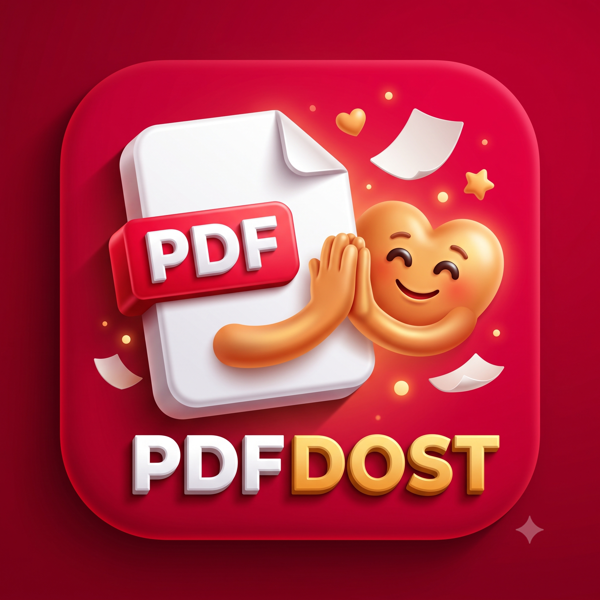

# PDFDost 📄✨

<p align="center">
  
</p>

<p align="center">
  <b>100% Free Forever • Privacy-First • Offline-First Document & PDF Utility</b><br>
  <i>Crafted with dedication by <b>Vrushabh Dhote</b></i>
</p>

<p align="center">
  
  
  
  
  
<p align="center">
  <a href="https://devvrushabh.github.io/PDFDost/privacy.html"><b>🛡️ Live Privacy Policy (Indus Appstore Compliant)</b></a> •
  <a href="https://devvrushabh.github.io/PDFDost/"><b>🌐 Official Website</b></a> •
  <a href="https://github.com/devvrushabh/PDFDost/releases/latest"><b>⬇️ Download Latest APK</b></a>
</p>

---

## 📖 Table of Contents

- [Overview](#-overview)
- [Key Highlights](#-key-highlights)
- [How the App Works](#-how-the-app-works)
  - [1. Home Screen (Document Management & Scanning)](#1-home-screen-document-management--scanning)
  - [2. Files Screen (Storage & Exporting)](#2-files-screen-storage--exporting)
  - [3. Tools Screen (Complete PDF & Office Suite)](#3-tools-screen-complete-pdf--office-suite)
  - [4. Settings Screen (Customization & Trash Retention)](#4-settings-screen-customization--trash-retention)
- [All Features & Functional Details](#-all-features--functional-details)
  - [PDF Creation & Conversion Tools](#pdf-creation--conversion-tools)
  - [PDF Editing & Manipulation Tools](#pdf-editing--manipulation-tools)
  - [Document Organization & Sets](#document-organization--sets)
  - [Trash & 30-Day Auto-Retention](#trash--30-day-auto-retention)
- [Supported Formats](#-supported-formats)
- [Privacy & Security](#-privacy--security)
- [Project Architecture](#-project-architecture)
- [Getting Started & Installation](#-getting-started--installation)
- [Support the Project](#-support-the-project)
- [Author & Credits](#-author--credits)

---

## 🌟 Overview

**PDFDost** is a comprehensive, modern, and privacy-conscious PDF and document utility app for Android. Designed to replace ad-heavy, subscription-locked document scanner tools, PDFDost offers enterprise-grade document scanning, PDF conversion, editing, splitting, merging, watermarking, password encryption, and multi-folder organization—completely **free**, without watermarks, and entirely **offline**.

---

## 🚀 Key Highlights

- **🔒 100% Private & Offline**: No cloud uploads. Every scan, conversion, and password lock takes place locally on your device.
- **📁 Multi-Folder Document Organizing**: Group photos and scans into multi-page document sets with color-coded custom folders.
- **🔄 Drag-and-Drop Reordering**: Hold and drag pages or files to set the exact order before converting.
- **🗑️ 30-Day Trash Auto-Retention**: Deleted files are kept safely in the Trash bin for 30 days before permanent deletion, with instant 1-tap restore.
- **🎨 Modern Material 3 Design**: Clean coral/salmon visual accent palette, smooth transitions, and dynamic Dark/Light theme support.
- **💸 Truly Free & Ad-Free**: No paywalls, no subscriptions, no forced account signups.

---

## 📱 How the App Works

PDFDost is organized into four main tabs accessible via the bottom navigation bar:

```
[ 🏠 Home ]      [ 📁 Files ]      [ 🛠️ Tools ]      [ ⚙️ Settings ]
```

### 1. Home Screen (Document Management & Scanning)

The Home screen is your primary workspace for creating and managing document sets:

- **Document Sets View**: Scanned documents appear as organized card sets displaying real-time page count badges (`N`), completion badges, and high-resolution cover thumbnails.
- **Folder Filtering & Creation**:
  - Tap the **`📁+`** icon to create custom folders with personalized names and accent colors.
  - Use the folder dropdown next to **Documents (N)** to instantly filter documents by folder.
- **Document Actions (Three-Dot Menu `⋮`)**:
  - **Open & View**: Preview all pages in the set.
  - **Add Pages**: Import additional images or capture more pages with the camera.
  - **Move to Folder**: Assign or reassign documents to any existing folder.
  - **Export as PDF**: Instantly generate and export the document set into a PDF.
  - **Rename & Delete**: Rename document titles or safely move them to the 30-day Trash bin.
- **Dual Floating Action Button (FAB)**:
  - **Camera (`📷`)**: Instantly launches the on-device camera to scan documents page-by-page.
  - **Action Menu (`+`)**: Opens the *Create or Import* bottom sheet to create new folders, import multiple gallery images into a new set, or start camera scanning.

### 2. Files Screen (Storage & Exporting)

The Files tab acts as the built-in file manager for all generated PDFs and documents:

- **Categorized Tabs**: Filter documents by **All**, **Created PDFs**, **Scanned**, or view the **Trash**.
- **Search Bar**: Quickly search and filter saved documents by name.
- **Sort Options**: Sort documents by Date Modified (newest/oldest), File Name (A–Z), or File Size.
- **File Management**:
  - Tap any file to open it in the built-in PDF viewer or your device's default reader.
  - Share files via WhatsApp, Gmail, Telegram, Bluetooth, or any installed application.
  - Print documents directly to Wi-Fi or Bluetooth printers.
  - Move files to the 30-day Trash bin with an instant "Undo" toast notification.

### 3. Tools Screen (Complete PDF & Office Suite)

The Tools screen contains a complete suite of specialized document conversion and editing utilities:

| Tool | Icon | Description |
| :--- | :---: | :--- |
| **Images to PDF** | 🖼️ | Convert single or multiple images (JPG, PNG, WebP) into PDF with custom margins and page sizes. |
| **Word to PDF** | 📝 | Convert `.docx`, `.doc`, `.xlsx`, `.csv`, `.txt`, and other office documents into PDF. |
| **Merge PDF** | 📑 | Combine two or more PDF files into a single consolidated PDF document with hold-and-drag reordering. |
| **Split PDF** | ✂️ | Extract specific pages or split multi-page PDFs by custom page ranges (e.g., `1-3, 5, 8-10`). |
| **PDF to Word** | 📄 | Convert PDF documents into editable Microsoft Word (`.docx`) files. |
| **PDF to PowerPoint**| 📊 | Convert PDF presentation slides into editable PowerPoint (`.pptx`) decks. |
| **PDF to Excel** | 📈 | Extract tabular data and text from PDF documents into Excel spreadsheets (`.xlsx`). |
| **PDF to JPG** | 🌄 | Extract high-resolution JPEG image files for every page of a PDF. |
| **Page Numbers** | 🔢 | Stamp customized page numbers on PDF headers/footers with alignment and custom prefix options. |
| **Watermark PDF** | 🏷️ | Add custom text watermarks across PDF pages with adjustable opacity, angle, and font size. |
| **Rotate PDF** | 🔄 | Rotate all pages of a PDF by 90°, 180°, or 270° to fix orientation. |
| **Lock PDF** | 🔒 | Secure PDF documents with strong password protection and encryption. |

### 4. Settings Screen (Customization & Trash Retention)

- **Developer Showcase**: Features the **Free App By Vrushabh Dhote** recognition badge.
- **Support & UPI Donations**: Direct donation via UPI (`8830638458-2@ybl`) with an interactive QR code modal for scanning and contributing to open-source development.
- **Preferences**:
  - **Dark Mode**: Switch between sleek Dark Theme and clean Light Theme.
  - **Data Usage Controls**: Toggle mobile data confirmation alerts.
  - **OCR Language Selection**: Choose optical character recognition language models.
- **Trash & Auto-Retention Hub**:
  - View all deleted documents and sets along with their countdown of remaining days (out of 30 days).
  - 1-click **Restore** returns items directly back to Home or Files.
  - **Delete Permanently** and **Empty Trash** for permanent on-device storage cleanup.

---

## 🛠️ All Features & Functional Details

### PDF Creation & Conversion Tools
- **Hold-and-Drag Reordering**: All converter tools support long-pressing and dragging file items up/down to arrange the exact page sequence prior to conversion.
- **Multi-File Batch Selection**: Pick multiple photos or documents simultaneously using Android's native file picker.
- **Quality & Compression**: Optimized PDF generation ensures high visual fidelity while maintaining compact file sizes.

### PDF Editing & Manipulation Tools
- **Visual Split Selector**: Interactively choose split ranges or specific single pages to extract.
- **Custom Watermarking**: Set text, opacity (0.1 to 1.0), rotation angle (diagonal or horizontal), and custom font colors to safeguard sensitive documents.
- **Password Locking**: Encrypt PDF files with user-defined passwords with confirmation dialogs and individual completed document delete controls.

### Document Organization & Sets
- **Document Grouping**: Multiple imported photos or scanned pages are neatly grouped into single document sets rather than cluttering storage with isolated files.
- **Visual Cover Mockups**: Sets automatically render vector covers or thumbnails representing the first scanned page.

### Trash & 30-Day Auto-Retention
- Deleted items are moved to an isolated Trash cache (`StorageEngine.moveToTrash`).
- Items record a precise deletion timestamp.
- Upon app launch and Trash viewing, files older than 30 days are automatically pruned permanently.
- Users can restore any document within the 30-day window without losing file contents or metadata.

---

## 📁 Supported Formats

| Category | Supported File Extensions |
| :--- | :--- |
| **Images** | `.jpg`, `.jpeg`, `.png`, `.webp`, `.bmp`, `.heic` |
| **Word Documents** | `.doc`, `.docx` |
| **Spreadsheets** | `.xlsx`, `.xlsm`, `.xlsb`, `.xls`, `.xlw`, `.xltx`, `.xltm`, `.xlt`, `.csv`, `.ods` |
| **Text & Data** | `.txt`, `.xml`, `.prn` |
| **PDF Documents** | `.pdf` |

---

## 🔐 Privacy & Security

PDFDost is engineered from the ground up with a **zero-cloud, privacy-first** philosophy:

1. **No External Server Calls**: All image compression, document grouping, encryption, and conversions occur directly in the local sandbox of your Android device.
2. **No Data Tracking**: PDFDost has no telemetry, tracking SDKs, analytics, or third-party advertising modules.
3. **No Account Required**: The application does not require registration, email addresses, or phone numbers to unlock any feature.

---

## 🏗️ Project Architecture

```
PDFDost/
├── .github/workflows/
│   └── build.yml               # Automated Android release APK CI/CD pipeline
├── android/                    # Android native project files & Gradle scripts
├── android_custom/             # Custom native Android shell configuration
├── assets/                     # App icons, QR assets, and graphic resources
├── lib/
│   ├── main.dart               # App entrypoint, theme controller, navigation stack
│   ├── models/
│   │   └── models.dart         # DocumentSet, HistoryItem, TrashItem data models
│   ├── screens/
│   │   ├── home_tab.dart       # Home screen with sets, folders, and dual FAB
│   │   ├── files_tab.dart      # Files manager, sorting, filtering, and export
│   │   ├── tools_tab.dart      # Suite of 12 PDF creation, conversion, and editing tools
│   │   ├── settings_tab.dart   # Preferences, theme switch, UPI donate, and trash
│   │   ├── merge_pdf_screen.dart # Reorderable PDF merger
│   │   ├── split_pdf_screen.dart # Custom page range PDF splitter
│   │   ├── word_to_pdf_screen.dart # Word/Excel/Document to PDF converter
│   │   └── trash_screen.dart   # 30-day Trash retention manager
│   ├── services/
│   │   ├── pdf_engine.dart     # Core PDF processing and generation engine
│   │   └── storage_engine.dart # Local file persistence, history, and trash retention
│   └── widgets/
│       ├── app_logo.dart       # Unified branded PDFDost header logo
│       ├── export_modal.dart   # Interactive PDF export, share, and preview sheet
│       └── login_modal.dart    # Profile and account details sheet
├── pubspec.yaml                # Flutter project dependencies and assets config
└── README.md                   # Complete app documentation
```

---

## 📥 Getting Started & Installation

### Option 1: Download Pre-built Release APK
1. Go to the [GitHub Actions Releases](https://github.com/devvrushabh/PDFDost/actions).
2. Click on the latest workflow run on `main`.
3. Scroll down to **Artifacts** and download `pdfdost-flutter-release-apk`.
4. Transfer and install the `.apk` on any Android device running Android 7.0 (API 24) or higher.

### Option 2: Build from Source

#### Prerequisites
- [Flutter SDK](https://docs.flutter.dev/get-started/install) (3.24.x or newer)
- [Java Development Kit](https://adoptium.net/) (JDK 17)
- Android SDK (API 34/36)

#### Build Instructions
```bash
# 1. Clone the repository
git clone https://github.com/devvrushabh/PDFDost.git
cd PDFDost

# 2. Install Flutter dependencies
flutter pub get

# 3. Build release APK
flutter build apk --release

# The compiled APK will be generated at:
# build/app/outputs/flutter-apk/app-release.apk
```

---

## 💖 Support the Project

PDFDost is completely free, open-source, and maintained independently. If you enjoy using the app and want to support its continuous development, you can contribute via UPI:

<p align="center">
  <b>UPI ID:</b> <code>8830638458-2@ybl</code><br>
  <b>Payee:</b> Vrushabh Dhote
</p>

You can also donate directly from within the app by opening **Settings ➔ Support PDFDost** and scanning the QR code or tapping **Donate and Pay**.

---

## 👨‍💻 Author & Credits

- **Developer**: [Vrushabh Dhote](https://github.com/devvrushabh)
- **Email**: `vrushabhdhote29@gmail.com`
- **Project**: [devvrushabh/PDFDost](https://github.com/devvrushabh/PDFDost)

---

<p align="center">
  <i>Developed with ❤️ for seamless, privacy-respecting document workflows.</i>
</p>
